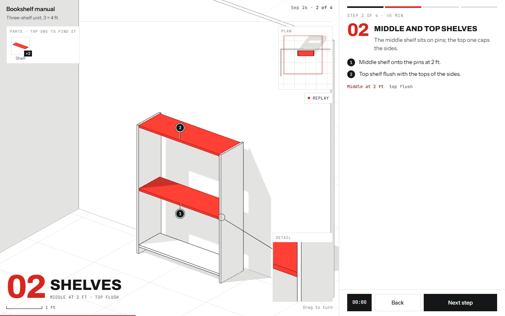
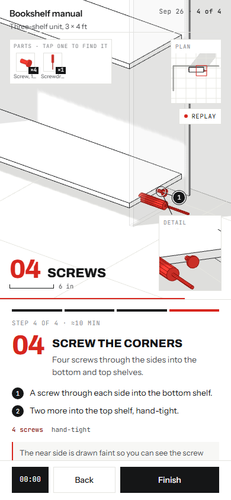

# 3D assembly manual

Describe a physical job (a build, an install, a repair) and get back one HTML
file: an interactive 3D step-by-step guide you can open on a phone. Each step
shows the parts it needs, animates them into place, and marks what to do with
numbered callouts, dimensions and a close-up detail.

It is drawn like an architectural diagram: a white model with ink edges on a
faint grid, with only what the current step adds or removes in red.

## What you give it

- What is being built or fixed, and roughly how big it is.
- Photos or a sketch of the space, if you have them. Claude estimates from them
  and marks anything it could not measure as "verify".
- The parts and tools, if you know them. If not, it lists them for you.

## What you get back

One `.html` file. Open it by double-clicking it, or put it on any static
host. It needs an internet connection to load Three.js and the fonts.

- A parts page, then one page per step, then a done page.
- Per step: a parts callout (tap a part to find it in the drawing), numbered
  actions, dimension lines, a scale bar, a plan view, a time estimate and one tip.
- Swipe or use the buttons to move between steps. It remembers where you stopped.

## How to use it

**Claude Code**
Copy this folder into `~/.claude/skills/` (all your projects) or
`.claude/skills/` (one project). Then ask, for example:

> Make a 3D step-by-step guide for building a 4 ft x 8 ft raised garden bed
> from cedar boards. Here are photos of the yard.

**Claude app (claude.ai or desktop)**
Zip this folder and upload it in your Claude settings under skills.

The skill is `SKILL.md`. `starter.html` is the engine it copies and fills in,
so keep the two files together.

## Good to know

- It is a drawing, not a construction document. Dimensions come from what you
  tell it or from photos, so check anything marked "verify" before cutting.
- Light mode only.
- Tested on Chrome at desktop width and at phone width (390 px). Not tested on
  Safari or Firefox.

Last tested: 2026-10-26
